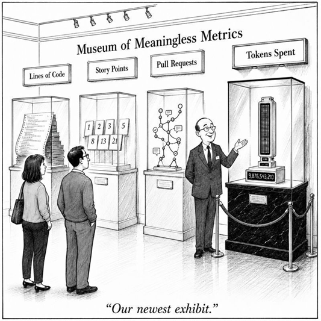

Your organization went AI-first six months ago.

The announcement was optimistic. The demo was impressive. The velocity graph moved — not a little, a lot. Forty percent faster. Features that took a week took three days. The sprint board moved like it had somewhere to be. Everyone agreed: this was working.

Then the hiring freeze. Not announced with fanfare. Just a quiet budget meeting where the open requisitions were removed. The team that built the system would stay the team that maintained it. AI would handle the rest.

Three months later, a restructuring. The kind that uses words like "efficiency" and "realignment." The velocity graph never dipped. It never even paused.

But the team that understood the system — the people who knew why the payment reconciliation ran at three in the morning, who could trace a production failure to its root in twenty minutes, who had spent years building the institutional knowledge that no documentation could capture — that team was half the size.

The dashboard still looks great.

Was this augmentation? Was it always replacement?

---

## The Two Algorithms

Two things are happening simultaneously in every organization that adopts AI for engineering. They are not the same thing.

**Algorithm 1 — Augmentation.** AI makes engineers more capable. The same team, with deeper understanding and better judgment, amplified by tools that handle the mechanical work while the humans focus on the work that requires thinking. The engineer is the product. AI is the lever.

**Algorithm 2 — Replacement.** AI makes engineers expendable. Fewer people, same output, lower cost. The output is the product. The engineer is the input being optimized away.

Both algorithms produce the same velocity graph. Both show the same cost savings. Both look like "AI is working." The dashboard cannot tell them apart. The sprint metrics cannot tell them apart. The stakeholders who celebrate the numbers cannot tell them apart.

The divergence is invisible. Until it isn't.

---

## The Equation That Reveals the Choice

There is a simple economic relationship that makes the choice visible — if you are willing to look at it.

Before AI, value was a function of your engineering team. More capable team, more value. The equation was straightforward: you invested in people, and the people produced the output.

After AI, the equation splits.

**The augmentation equation:** Same team, multiplied by the productivity gain, minus the cost of AI. You invest in people *and* tools. The people get more capable. The value scales with their capability. The AI cost is real but the return compounds — because the humans are learning, growing, building judgment that makes the next cycle better.

**The replacement equation:** Maintain the same value with fewer engineers. The productivity multiplier becomes a reduction factor. One hundred engineers become eighty. The cost of AI is lower than the cost of the twenty engineers it replaced. The spreadsheet looks right.

Both equations share a hidden assumption: the push force increased, but the resistance did not. More code ships faster — but QA has the same capacity, the same testers, the same cycle time. And now QA is trying to use AI too, to keep up. More force on the same road, with the same traffic cops, and the cops are also driving faster. The result is not speed. It is things leaking into regression. Bugs reaching customers. A release cadence that outpaces the team's ability to verify what it just shipped.

The augmentation equation produces a team that gets stronger over time. The replacement equation produces a team that gets smaller over time. Both equations produce the same output next quarter. The divergence appears next year, and the year after, and the year after that — in the institutional knowledge that either accumulated or evaporated, in the judgment that either deepened or disappeared, in the organization's ability to do the work that AI cannot do.

Most organizations present the augmentation equation to their engineers. The board is hearing the replacement equation. The disconnect is not accidental. It is the central dishonesty of the AI adoption narrative: we are doing this to make you better, when the budget says we are doing this to need fewer of you.

---

## The Metrics That Betray You

What you measure reveals what you chose.

If your dashboard tracks the percentage of developers actively using AI, the proportion of AI-assisted commits, the number of AI-assisted pull requests, and the output per engineer — you are measuring replacement. You are measuring how much human output the tool has substituted. These are the numbers that justify headcount reduction. These are the numbers that go in the board deck.

If your dashboard tracks AI skill maturity levels, knowledge sharing contributions, review depth over time, whether engineers can explain code they did not write, and whether the team's collective understanding of the system is growing or shrinking — you are measuring augmentation. You are measuring whether the tool made humans more capable. These are the numbers that justify continued investment in people. These are the numbers that rarely go in the board deck.

The metrics you choose are a confession.

An organization running the augmentation algorithm uses the full measurement framework: adoption, productivity, quality, engineering excellence, capability, business value, governance. It measures whether AI is creating *capability*, not just output.

An organization running the replacement algorithm uses the first two rows. Adoption and productivity. How many people are using it, and how fast are they moving. That is enough — because the goal was never to understand the impact. The goal was to justify the decision that was already made.

Look at your dashboard. Look at what is on it and what is not. The absence is the confession.

---

## The Rollout That Never Happened

There is a responsible way to adopt AI in engineering. It looks like this:

Establish a baseline. Measure your current delivery, quality, and operational metrics for four to eight weeks before introducing anything new. Know where you stand.

Run pilot teams. Select a few teams to adopt the tools. Compare their trends against their own baseline — not against a different team, not against a vendor case study. Against themselves.

Measure outcomes, not activity. Focus on improvements in delivery speed, quality, and developer experience — not raw prompt counts or tool usage. Ask whether the work is getting *better*, not just faster.

Build capability. Provide training. Create internal guides. Share successful workflows across teams. Invest in the humans who will use the tools.

Scale with governance. Define approved tools, code review expectations, security checks, and data handling policies. Then expand — deliberately, with the evidence from the previous steps.

This is the roadmap that works. It takes time. It requires patience. It produces honest answers, including the possibility that the answer is "not yet, not here, not for this system."

Algorithm 2 organizations do not follow this roadmap. They skip to step five. Sometimes they skip to step five before step one exists. The pilot was not a pilot — it was a press release. The baseline was not a baseline — it was a target the board had already set. The governance was not governance — it was a policy document written after the decision was made, to cover the decision that was already in motion.

The rollout was theater. The decision was made before the rollout started.

---

## The Terminal Condition

Algorithm 2 has a terminal condition, and it is not a distant future problem. It is a structural reality that compounds with every cycle.

Every time you replace human capability with AI output, you reduce the organization's ability to do the work that AI cannot do. And the work AI cannot do is exactly the work that matters most:

The complex systems with undocumented decisions made years ago for reasons nobody remembers. The institutional knowledge that lives in people, not in documentation. The judgment that keeps production running when the agent fails. The frontier work that requires deep understanding of *why* the system is the way it is — not just *how* it works, but why this approach was chosen over every other.

This is the tension this series has been building toward. The frontier is, by definition, the place where the industrialized tools do not yet work. Augmentation keeps the frontier alive — it makes humans more capable of doing the work that requires understanding, judgment, and institutional knowledge. Replacement industrializes the frontier — and in doing so, destroys the very capability that the frontier depends on.

The organization that chose Algorithm 2 will discover, at the worst possible moment, that it no longer has the human capability to do the work that matters. Not because the people left. Because the organization chose to stop developing them. Because the velocity graph said everything was fine. Because the dashboard showed adoption up, output up, cost down. Because no one was measuring the thing that was disappearing — the understanding, the judgment, the institutional memory that cannot be generated by a prompt but can be destroyed by the decision to stop nurturing it.

---

The velocity graph looks the same in both organizations. It will look the same for a long time.

One has engineers who understand the system. Who can explain why the payment module works the way it does. Who can trace a production failure to its root cause in twenty minutes. Who were developed, not replaced.

The other has engineers who review AI output quickly. Who close tickets fast. Who cannot explain the code they shipped last sprint. Who were optimized, not augmented.

The graph does not show the difference. The sprint does not surface it. The standup does not ask about it.

Then something breaks. A system fails. A production incident cascades. The Slack channel lights up. The team assembles.

And only one of the organizations can fix it.

The two algorithms produce the same graph. The difference is what happens when the graph stops being enough.

Which algorithm is your organization actually running — and would you know if the answer was the one you didn't intend?





<h4>More from {{ s }}</h4>
<ul>

<li>

<strong>{{ post.title }} (Current)</strong>

<a href="{{ post.url | relative_url }}">{{ post.title }}</a>

</li>

</ul>



